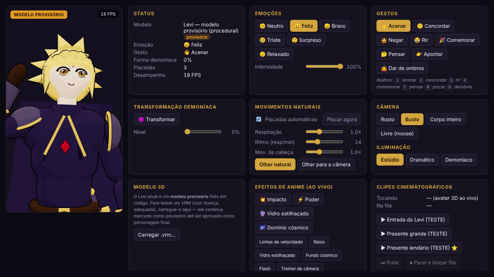
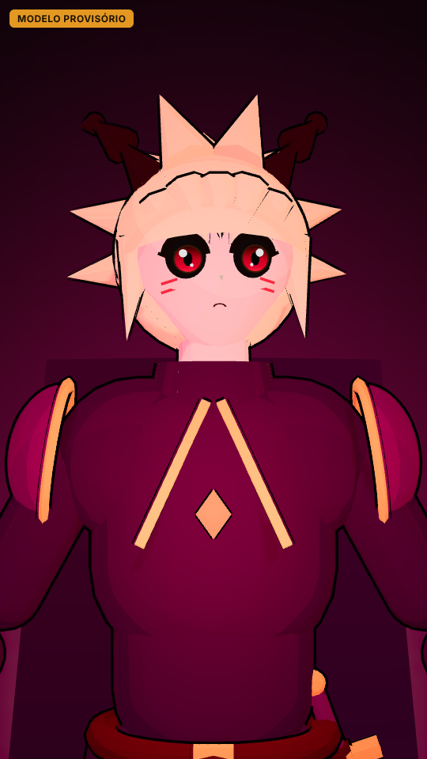
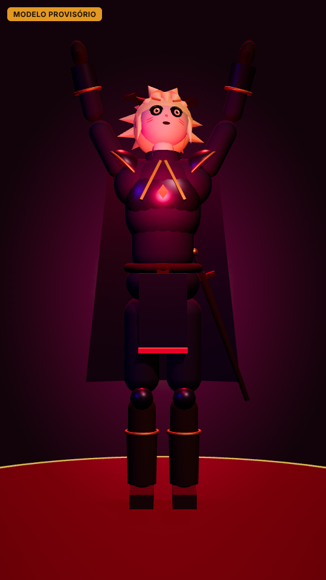
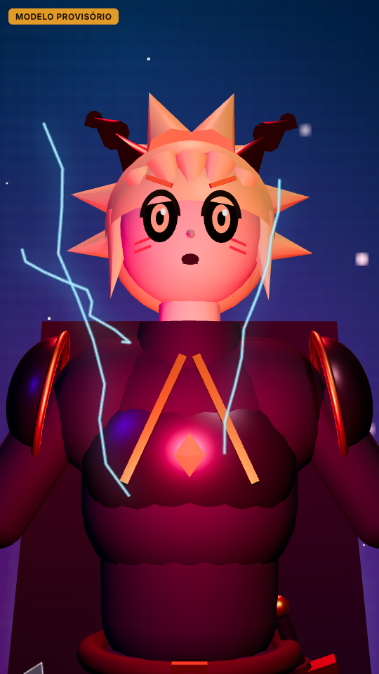
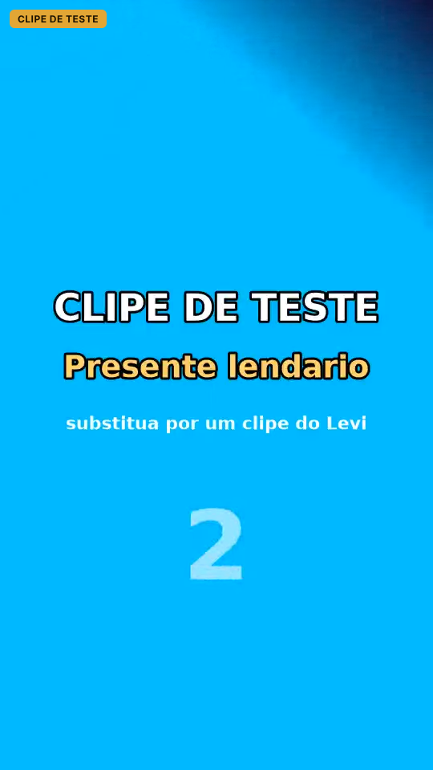

# ZYNOX LIVE IA — LEVI 3D

Apresentador virtual 3D para lives: um personagem inspirado na estética de príncipe
demoníaco de anime, que respira, pisca, olha, gesticula, muda de emoção e se transforma.

> **Versão 0.2 — Etapa 1 (base) + Momentos cinematográficos (modelo híbrido).**
> O personagem atual é um **modelo provisório** gerado em código. Ele NÃO é o
> personagem final — a interface mostra o selo "MODELO PROVISÓRIO" o tempo todo.

| Painel | Forma demoníaca | Corpo inteiro |
|---|---|---|
|  |  |  |
| **Domínio cósmico + raios** | **Clipe entrando por cima do 3D** | |
|  |  | |

<sub>Capturas do teste automatizado (renderização por software, sem GPU).</sub>

## O que funciona hoje

| Recurso | Estado |
|---|---|
| Avatar 3D real (malhas 3D com esqueleto humanoide padrão VRM) | ✅ provisório |
| Cabelo loiro espetado, roupa de guerreiro (armadura, ombreiras, capa, espada) | ✅ provisório |
| Respiração (peito, ombros, capa), piscadas naturais (incl. duplas), olhar e cabeça | ✅ |
| 6 emoções com transição suave (rosto + postura) | ✅ |
| 8 gestos: acenar, concordar, negar, rir, comemorar, pensar, apontar, dar de ombros | ✅ |
| Transformação demoníaca gradual (chifres, olhos, marcas, aura, luz) | ✅ |
| Câmeras (rosto, busto, corpo, livre) e 3 iluminações | ✅ |
| Página de visualização `/viewer` (vertical, fundo transparente p/ OBS) | ✅ |
| Painel `/admin` para testar tudo + atalhos de teclado | ✅ |
| Painel controla o viewer em outra aba do mesmo navegador | ✅ |
| **Efeitos de anime ao vivo**: linhas de velocidade, raios, vidro estilhaçado, fundo cósmico, flash, tremor | ✅ |
| **Clipes cinematográficos** (vídeos de IA pré-gerados) com fila, prioridade e transição 3D ↔ clipe | ✅ com clipes de TESTE |
| Regras de reação (presentes por faixa, seguidor, curtidas) + simulador de eventos | ✅ simulado — eventos reais na etapa 4 |
| Carregar um arquivo `.vrm` para teste (adaptador pronto) | ⚠️ implementado, testado só com modelo simulado |
| Voz, sincronização labial, IA, TikTok, OBS, cenários, batalhas, universo | ⏳ próximas etapas ([roadmap](docs/ROADMAP.md)) |

## Requisitos (Windows 11)

- **Node.js 22 LTS** (ou 20.9+) — instale pelo site oficial nodejs.org.
- Navegador Chrome ou Edge atualizado.
- Testado para rodar em notebook Intel Core i5-1334U / 8 GB RAM (GPU integrada Iris Xe):
  use `?quality=baixa` se o FPS ficar abaixo de 30.

## Como rodar

No PowerShell, dentro da pasta do projeto:

```powershell
npm install        # primeira vez
npm run dev        # modo desenvolvimento
```

Abra:

- **http://localhost:3000/admin** — painel com pré-visualização e controles
- **http://localhost:3000/viewer** — personagem em tela cheia

Para uso contínuo (mais leve que o modo dev):

```powershell
npm run build
npm start
```

Tudo funciona **offline** depois do `npm install` — não há chamadas a APIs externas.

## Como testar

```powershell
npm test           # 63 testes automatizados (animação, comandos, modelo, gestos, efeitos, clipes, regras, URL)
npm run typecheck  # checagem de tipos TypeScript
npm run check      # os dois acima
```

Teste no navegador (opcional, gera capturas em `smoke-output/`), com o servidor rodando:

```powershell
npm install --no-save playwright
npx playwright install chromium
npm run smoke
```

### Roteiro de teste manual

1. Abra `/admin`. O Levi deve respirar (peito e ombros) e piscar sozinho a cada 2–6 s.
   O contador "Piscadas" no painel sobe.
2. Clique nas emoções — o rosto e a postura mudam suavemente.
3. Clique nos gestos (ou teclas `1`–`5`). "Acenar" deve ficar com a mão ao lado da cabeça.
4. Clique em **😈 Transformar** (ou tecla `D`) com a luz **Demoníaco**: chifres crescem, olhos ficam vermelhos.
5. Troque as câmeras; em **Livre** arraste com o mouse.
6. Abra `/viewer` em outra aba e use o painel: o viewer repete os comandos.
7. Em **Efeitos de anime**, clique em **🌌 Domínio cósmico** (ou tecla `9`).
8. Em **Simular eventos**, clique em **🐉 Presente lendário**: o efeito dispara e o clipe de teste
   entra por cima do 3D (com som no `/viewer`). Ao terminar, a live volta ao avatar.

## Atalhos do painel

`1` acenar · `2` concordar · `3` rir · `4` comemorar · `5` pensar · `B` piscar · `D` liga/desliga forma demoníaca ·
`6` impacto · `7` poder · `8` vidro estilhaçado · `9` domínio cósmico

## Parâmetros do `/viewer` (e `/admin`)

| Parâmetro | Efeito |
|---|---|
| `transparent=1` | Fundo transparente (para OBS) |
| `camera=rosto\|busto\|corpo\|livre` | Enquadramento inicial |
| `lighting=estudio\|dramatico\|demoniaco` | Iluminação inicial |
| `quality=baixa\|media\|alta` | Resolução/sombras (baixa = notebooks) |
| `nobadge=1` | Esconde o selo "MODELO PROVISÓRIO" (só para capturas internas) |
| `vrm=/models/arquivo.vrm` | Usa um VRM de `public/models/` (somente caminhos locais) |

### OBS (prévia — integração completa na etapa 5)

Fontes → **+** → *Navegador* → URL `http://localhost:3000/viewer?transparent=1&camera=busto&quality=baixa`,
largura **1080**, altura **1920**. Nada aqui inicia transmissão: a live só começa quando você
clicar em "Iniciar transmissão" no OBS.

> Limitação atual: o painel controla o viewer por BroadcastChannel, que funciona entre abas
> do mesmo navegador, mas **não** alcança o navegador interno do OBS. Isso será resolvido
> com um servidor WebSocket local na etapa do OBS.

## Estrutura

```
src/
  app/                 Rotas Next.js: / (início), /admin, /viewer
  core/                Lógica pura (sem React/Three) — testável em Node
    animation/         AnimationController + camadas (respiração, piscada, cabeça, emoções, gestos, demônio)
    control/           Protocolo de comandos validados + barramento entre abas
    fx/                Linha do tempo dos efeitos de anime
    clips/             Manifesto e fila de clipes cinematográficos
    reactions/         Regras evento da live → reação
  avatar/              Renderização 3D
    procedural/        Modelo PROVISÓRIO do Levi feito em código
    rigs/              Adaptadores Pose → modelo (ProceduralRig, VrmRig)
    scene/             Câmera, iluminação, presets
    vrm/               Carregador de arquivos .vrm
    fx/                Desenho dos efeitos (camada 2D, fundo cósmico) e reprodutor de clipes
  state/               Estado da cena (zustand) e runtime (controlador + comandos)
  ui/                  Telas do painel e do visualizador
  modules/             Módulos futuros (voz, IA, TikTok, OBS, cenários, batalhas, universo, banco)
public/clips/          Clipes + clips.json (os incluídos são de TESTE)
docs/                  Arquitetura, avatar, clipes, roadmap, licenças
scripts/smoke.mjs      Teste no navegador
```

Mais detalhes: [Arquitetura](docs/ARQUITETURA.md) · [Avatar e modelo final](docs/AVATAR.md) · [Clipes cinematográficos](docs/CLIPES.md) ·
[Roadmap](docs/ROADMAP.md) · [Licenças](docs/LICENCAS.md)
